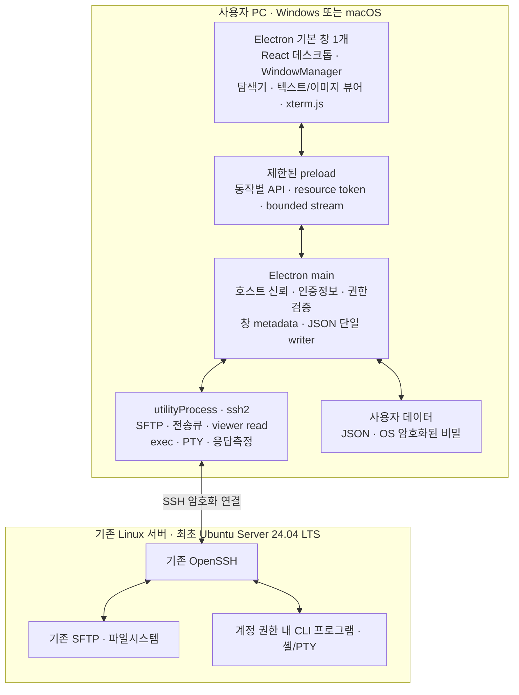

# sshOS(시오스) 시스템 아키텍처 v6

2026-11-15. 설계 문서이며 제품 구현·성능 검증은 미착수다. 규범 동작은 [개발 계획](02-development-plan.md), 내부 창은 [상호작용 명세](09-desktop-interaction-spec.md)를 따른다.

## 1. 책임과 신뢰 경계

| 구성 | 책임 | 하지 않는 일 |
| --- | --- | --- |
| Renderer | 로컬 desktop/window 상태, xterm, viewer, 진행 표시 | 로컬 OS shell/fs/net 직접 호출, SSH 인증, 비밀 복호화 |
| Preload | 승인된 method와 데이터 stream 전달 | 자유 invoke/임의 로컬 exec/readFile 노출 |
| Main | sender/schema/token 검증, 프로필·지문·OS 암호화, 단일 JSON writer, native dialog | 파일 내용을 영구 캐시하거나 출력/입력 로그 저장 |
| UtilityProcess | SSH 모든 socket과 remote operation, 전송/실행 상태, bounded I/O, hash/probe | 원격 helper 설치, HTTP 서버, 무제한 buffer |
| 이미지 decode Web Worker | 검증된 raster byte의 decode,5초 기한 | SSH 이벤트 처리, HTML/SVG 실행 |
| 기존 서버 | OpenSSH/SFTP·사용자 셸·실행 파일 | 시오스 전용 앱·상주 agent·DB를 새로 요구하지 않음 |

Chromium은 시오스 GUI 전체를 렌더링한다. 내부 작업 창은 DOM이며 원격 X11 창도 별도 BrowserWindow도 아니다. xterm.js는 클라이언트의 터미널 표시·입력 처리이고 원격 PTY는 기존 sshd가 제공한다. node-pty·WebSocket bridge·로컬 HTTP 서버는 필요하지 않다.

## 2. 서버별 연결과 채널

연결된 서버최대3개. 서버마다 control1, 필요 시 transfer1, 필요 시 execution1을 사용하므로 최대9 socket이다. 모든 socket에 같은 호스트 지문 검증과 인증 경계를 적용한다.

- control: metadata SFTP1, viewer SFTP최대2, probe최대1. viewer읽기는 전체4개.
- transfer: 실제 파일전송 task당1개 SFTP. 전체동시2개, 서버별1개. 완료 뒤 socket종료.
- execution: GUI exec와 PTY 합계 서버별4·전체6채널. 마지막 채널이 닫히면 socket종료. 한도 초과 요청을 숨겨 대기시키지 않는다.

서버가 MaxSessions/접속 한도로 거절하면 신규 요청만 실패시키고 다른 기존 작업은 유지한다. execution만 단절되면 파일전송/control은 유지한다. control이 단절되면 해당 서버의 세대를 종료하고 다른 두 연결도 닫는다. 다른 서버에는 전파하지 않는다. 자동 재접속·재실행은 없다.

## 3. 파일·실행 데이터 흐름

탐색은 SFTP 목록을 구조화 데이터로 표시한다. 파일 열기는 제한된 SFTP read → 임시 메모리 stream → strict text 또는 허용 raster decoder → 내부 뷰어다. 로컬 영구 파일 저장과 뷰어 열기는 다른 동작이다. 이미지 Web Worker의 ImageBitmap을 canvas로 전달하며 창을 닫을 때 bitmap/canvas 참조를 해제한다.

파일 실행은 entry/cwd token → 서버/인수 확인 → 고정된 인코딩 알고리즘 → SSH exec → stdout/stderr/종료 관측이다. 대화형 입력은 terminalToken에 귀속된 별도 PTY 경로다. 일반 파일 열기·서버 출력·파일명은 자동 명령 실행을 유발하지 않는다.

각 메시지는 serverId/sessionGeneration/backendEpoch/resourceId/requestId/sequence를 가진다. 상단 선택 서버나 현재 포커스를 보고 늦은 이벤트의 대상을 재결정하지 않는다. 포커스·최소화와 원격 작업 수명은 분리한다.

## 4. 저장·불확정 결과

프로필·지문·설정·영수증은 로컬 JSON, 저장을 선택한 비밀번호/passphrase는 OS 암호화다. 명령 인수·입력·출력·원격 파일 내용은 앱이 디스크에 자동 저장하지 않는다. 서버 셸 history나 OS swap을 통제한다고 보장하지 않는다. 앱 기능용 DB는 없으며 Chromium 내부 캐시는 별개다.

파일 전송은 temp → read-back 대조 → 배타 목적지 생성 → 기록으로 확정한다. read-back/hardlink는 비용과 파일시스템 제약을 수반한다. GUI 파일 보호 lock은 사용자 exec/PTY와 외부 writer를 통제하지 않는다.

원격 실행은 exit code/signal과 채널 close의 관측으로 표시한다. 중지 요청·채널 단절만으로 종료를 확정하지 않는다. JSON intent는 원격 실행과 분산 transaction을 구성하지 않으므로 애매한 결과를 자동 재실행하지 않는다.

## 5. 응답시간·통신·배포

상단 활성 서버의 control 연결에서 `/bin/true` exec 직전부터 정상exit+close까지 측정한다. probe전용 고정명령과 사용자의 exec/PTY를 분리한다. 값은 SSH 요청 완료시간이고 ICMP ping/순수 RTT가 아니다. 전체앱 비활성/최소화/절전은 probe를 중지하지만 내부창 최소화는 작업을 중지하지 않는다.

클라이언트 자체의 자동 네트워크는 사용자 SSH endpoint와 DNS뿐이다. 검색·AI·telemetry·원격 font·자동업데이트는 없다. 사용자가 원격에서 실행한 프로그램이 수행하는 네트워크 작업까지 앱이 차단하지 않는다.

Windows는 portable exe, macOS는 zip 안 app bundle이다. 내장 Electron/Node/Chromium을 배포하고 외부 개발 runtime·DB를 요구하지 않는다. 서버에는 기존 OpenSSH 기능 외 시오스 전용 설치가 없다. 제품 실행/플랫폼/서명 검사는 미실행이다.

## 6. 시안과 이전 구조 그림

[4초 desktop GIF](../design/mockups/desktop-motion-20261115/sshOS-desktop-motion.gif)는 겹침·이동·최소화·복원 개념을 보여준다. 수치·메뉴 완결성·지원범위는 이 그림이 아닌 현행 명세가 정한다. 이전 v5 구조 그림과 5영역 시안은 [시안 분류](../design/README.md)에 과거 자료로 표시한다. 과거 그림을 제품 구조에 다시 합치지 않는다.
