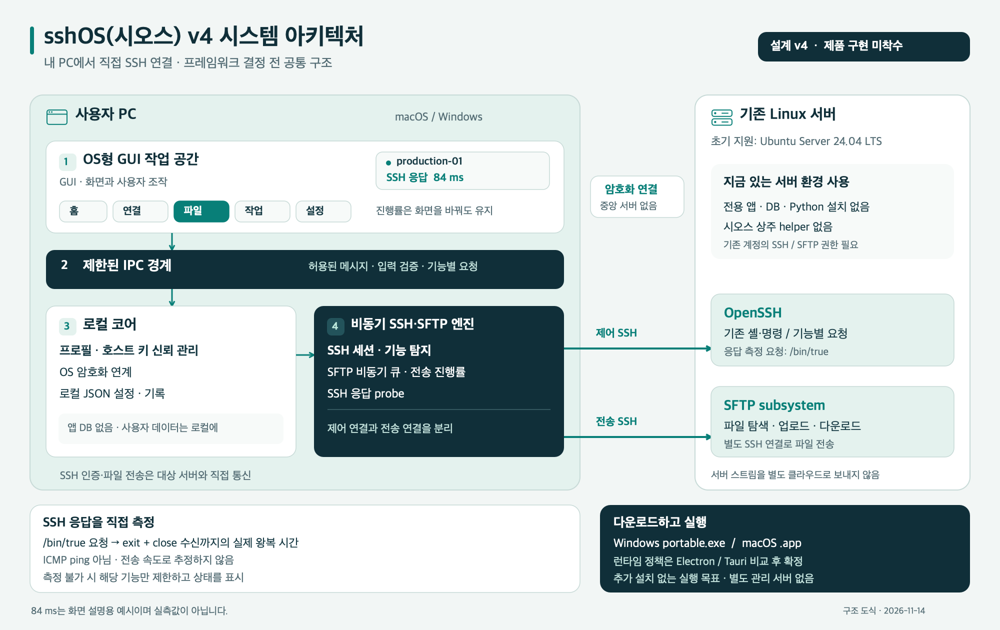

# sshOS(시오스) v4 시스템 아키텍처

이 문서는 v4의 **프레임워크 결정 전 공통 구조**다. Electron과 Tauri의 선택은 `pending`이며 제품 구현은 미착수다. 아래 그림은 구현·성능 검증 결과가 아니다. 제품 범위와 세부 동작은 현재 제품·개발 계획서 및 기계 명세가 정의한다.



[확대 가능한 SVG 원본](../design/sshOS-v4-architecture.svg) · [PNG 이미지](../design/sshOS-v4-architecture.png) · [재현용 그리기 소스](../design/architecture-render.js)

## 구성과 경계

| 구성 | 책임 |
| --- | --- |
| GUI | 홈·연결·파일·작업·설정으로 이루어진 OS형 작업 공간, 서버 표식, 비동기 전송 진행률과 SSH 응답 표시 |
| 제한된 IPC 경계 | 허용한 기능별 메시지와 검증된 입력만 GUI에서 로컬 코어로 전달 |
| 로컬 코어 | 연결 프로필, 호스트 키 신뢰, OS 암호화 연계, 로컬 JSON 설정·기록 관리 |
| 비동기 SSH·SFTP 엔진 | SSH 세션, SFTP 큐와 전송, 기능 탐지, SSH 응답 probe 실행 |
| 기존 Linux 서버 | 이미 제공되는 OpenSSH·SFTP·셸·명령을 사용. 초기 지원은 Ubuntu Server 24.04 LTS |

GUI의 요청은 `GUI → 제한된 IPC 경계 → 로컬 코어 → 비동기 SSH·SFTP 엔진 → 대상 서버` 순서로 전달한다. 결과와 진행 이벤트는 같은 경계를 역방향으로 돌아온다. 연결 대상과 작업 식별자는 화면 전환 뒤에도 유지한다.

| 후보 | 공통 계층의 구현 매핑 — 아직 선택하지 않음 |
| --- | --- |
| Electron | renderer → preload → main → utilityProcess의 SSH·SFTP 엔진 |
| Tauri 2 | WebView UI → invoke / capabilities → Rust core → async SSH·SFTP 엔진 |

그림의 상자는 논리 책임 경계이며 Tauri에서 각각 별도 OS 프로세스가 된다는 뜻이 아니다. 라이브러리·권한·프로세스의 구체적인 구현은 프레임워크 선택 후 명세로 확정한다.

제어용 SSH와 전송용 SSH는 별도 연결 역할을 갖는다. SFTP 전송 속도로 제어 연결의 응답 시간을 추정하지 않는다. 서버의 출력·파일명·로그는 GUI에서 실행할 코드가 아니라 데이터다.

## SSH 응답 관측

1. 기존 제어 SSH 연결에서 `/bin/true`를 요청한다.
2. 요청 시작부터 해당 명령의 `exit`와 `close` 수신까지 경과 시간을 관측한다.
3. 이 값은 SSH 채널·명령 처리까지 포함한 왕복 시간이다. ICMP ping이나 순수 네트워크 지연을 뜻하지 않는다.
4. 셸 실행 등 필요한 기능을 사용할 수 없으면 `측정 불가`를 표시하고 해당 기능만 제한한다. 사용 가능한 SFTP 기능까지 일괄 실패로 판정하지 않는다.

그림의 `SSH 응답 84 ms`는 화면 설명용 예시이며 실측값이 아니다.

## 로컬 저장과 서버 요구사항

앱의 기능 데이터는 JSON 설정·기록으로 관리하고 비밀정보 처리는 OS 암호화와 연계한다. 앱 전용 DB·DB 서버를 두지 않는다. 선택한 웹 런타임의 내부 캐시와 임시 실행 파일은 앱 기능용 DB와 구분한다.

서버에 시오스 전용 앱, 상주 helper, DB 또는 Python을 설치하지 않는다. 사용자는 기존 계정의 기본 SSH/SFTP 권한이 필요하다. 기존 셸·명령의 가용성은 기능별로 탐지한다. SSH 인증·파일 전송은 대상 서버와 직접 통신하며 중앙 관리 서버나 별도 클라우드를 경유하지 않는다. 키 인증에서 개인키 자체를 서버에 전송한다는 뜻은 아니다.

## 실행 형태

- Windows: `.exe` 중심 배포를 목표로 한다. Electron portable의 임시 해제 또는 Tauri WebView2의 사전 설치·동봉 정책은 비교 후 확정한다.
- macOS: ZIP을 풀면 나오는 `.app` bundle 실행. Finder의 앱 하나는 내부적으로 여러 파일을 포함한다.
- 사용자에게 별도 개발 도구·DB·Python 설치를 요구하지 않는다. 웹 런타임 추가 설치 0이라는 목표의 충족 방식은 프레임워크 결정 후 고정한다.

다운로드 파일 하나와 물리 파일 하나를 구분한다. 설정·캐시·임시 파일까지 전혀 만들지 않는 앱이라는 뜻은 아니다.

## 이미지 재현과 검수

재현용 소스는 제품 구현 코드가 아니라 SVG와 PNG를 그리는 문서 도구다. macOS 기본 AppKit·Foundation과 Apple SD Gothic Neo 글꼴을 사용하며 외부 패키지를 설치하지 않는다. 출력은 이 프로젝트의 `design` 안으로 제한한다.

프로젝트 루트에서 실행한다.

```sh
osascript -l JavaScript design/architecture-render.js "$PWD"
```

같은 그리기 명령에서 2000×1260 SVG와 PNG를 함께 만든다. 내보낸 PNG를 열어 한글 가독성·상자 경계·연결선·문구의 일치를 확인한다. 그림에서 사용한 구조와 예시 수치는 제품의 실행 검증을 대신하지 않는다.
