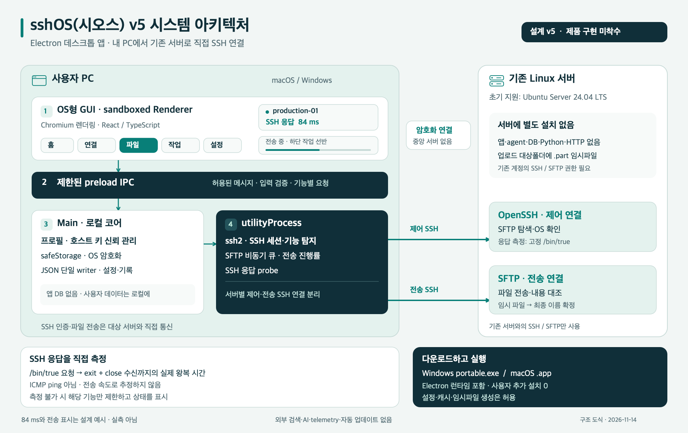

# sshOS(시오스) v5 시스템 아키텍처

프레임워크는 **Electron으로 확정**했다. 이 문서는 계획한 구조를 설명하며 **제품 구현은 미착수**다. 세부 메시지·상태·권한·수치·지원 조건은 [개발 계획서](02-development-plan.md)가 규범이다. 그림은 실행 결과나 성능 검증 자료가 아니다.



[확대 가능한 SVG](../design/sshOS-v5-architecture.svg) · [PNG](../design/sshOS-v5-architecture.png) · [재현용 그리기 소스](../design/architecture-render.js)

## 프로세스와 책임

| 구성 | 책임과 경계 |
| --- | --- |
| Sandboxed renderer | Chromium이 React·TypeScript GUI 전체를 렌더링한다. 홈·연결·파일·작업·설정, 우측 상단 서버·SSH 응답, 하단 전송 진행률을 표시한다. 원격 연결이나 로컬 파일 쓰기를 직접 수행하지 않는다. |
| 제한된 preload IPC | 허용된 메시지와 검증된 입력만 renderer와 main 사이에 전달한다. 범용 셸 실행·파일 접근 API를 GUI에 노출하지 않는다. |
| Main | 연결 프로필·호스트 키 신뢰·safeStorage 기반 OS 암호화를 담당한다. 앱 기능 데이터의 JSON 파일은 main만 쓰는 단일 writer 구조다. |
| Utility process | 앱당 하나의 `utilityProcess`에서 `ssh2` 기반 SSH·SFTP 엔진을 실행한다. 세션·기능 탐지·비동기 큐·진행 이벤트·응답 관측을 담당한다. |
| 기존 Linux 서버 | 이미 제공되는 OpenSSH와 SFTP를 사용한다. 초기 지원 OS는 Ubuntu Server 24.04 LTS다. 시오스 서버 앱을 설치하지 않는다. |

요청 흐름은 `renderer → preload → main → utilityProcess → 대상 서버`다. 결과·진행 이벤트는 같은 경계를 역방향으로 돌아온다. 화면을 전환해도 작업의 서버·계정·경로는 바뀌지 않는다. 서버 출력과 파일명은 화면에 표시할 데이터이며 실행할 코드가 아니다.

서버별 제어 연결과 필요할 때 여는 전송 연결을 분리한다. 전역·서버별 전송 동시성, 큐 순서, 재연결 정책은 개발 계획서의 연결·전송 계약을 따른다. 제어 응답을 전송 속도로 추정하지 않는다.

## SSH 응답과 OS 탐지

1. 기존 제어 SSH 연결의 exec 채널에서 고정 명령 `/bin/true`를 요청한다.
2. 요청 시작부터 해당 명령의 `exit`와 `close`를 모두 수신할 때까지 경과 시간을 관측한다. 성공·실패·시간 초과 판정은 개발 계획서의 probe 계약을 따른다.
3. 이 값에는 SSH 채널과 명령 처리 시간이 포함된다. ICMP ping 또는 순수 네트워크 지연이라고 표시하지 않는다.
4. exec가 허용되지 않으면 SSH 응답을 `측정 불가`로 표시한다. 별도로 사용 가능한 SFTP 기능까지 일괄 실패로 판정하지 않는다.
5. OS 정보는 SFTP로 `/etc/os-release`를 크기 제한 내에서 읽고 데이터로 해석한다. 내용을 실행하거나 셸에서 `source`하지 않는다. 읽기 한도와 필드 검증은 개발 계획서가 정한다.

그림의 `SSH 응답 84 ms`와 진행 막대는 설계 예시다. 측정값·완료된 전송·현재 접속한 서버를 나타내지 않는다.

## 파일 전송과 저장 경계

업로드의 `.part` 임시파일은 사용자가 지정한 원격 전송 대상 폴더에 생긴다. 다운로드 임시파일은 로컬 대상 폴더에 생긴다. 앱은 서버에 별도의 상태 저장 서비스나 DB를 만들지 않는다.

완료 파일 게시에는 개발 계획서가 정한 배타적 생성 절차를 사용한다. 필요한 원격 확장이 없으면 해당 쓰기·전송 기능을 제한하고 덮어쓰기로 우회하지 않는다. 임시파일 정리와 실패 후 상태는 전송 계약에 따라 표시한다. 디렉터리 rename·재귀 작업·덮어쓰기는 이 버전의 범위가 아니다.

프로필·신뢰 기록·설정·기록 등 앱 기능 데이터는 로컬 JSON으로 관리한다. 비밀정보는 `safeStorage`와 OS 암호화를 연계한다. Electron/Chromium의 내부 캐시와 임시 실행 파일은 앱 기능 데이터용 DB와 구분한다. 개인키 자체를 서버에 전송하지 않는다.

## 네트워크와 서버 요구사항

앱 기능의 네트워크는 사용자가 지정한 대상 서버와의 SSH·SFTP 통신으로 제한한다. 중앙 관리 서버, 온라인 오류 검색, AI 요약, telemetry, 자동 업데이트를 두지 않는다. 로컬 GUI가 별도 HTTP 서버를 필요로 하는 구조도 아니다.

원격 서버에는 전용 helper·상주 agent·DB·Python·HTTP 서비스를 설치하지 않는다. 기본 SSH·SFTP 권한이 필요하다. 기능별로 필요한 권한과 확장을 확인하며 탐지 결과를 지원·제한 상태로 표시한다.

## 배포와 실행

- Windows: Electron portable `.exe`를 실행한다. 내부 런타임과 리소스의 임시 해제를 허용한다.
- macOS: ZIP을 풀면 나오는 `.app` bundle을 실행한다. Finder의 앱 하나는 내부적으로 여러 파일을 포함한다.
- Electron 런타임은 배포본에 포함한다. 사용자는 별도 Node.js·Electron·Chrome·DB·Python을 설치하지 않는다.

다운로드 파일 하나와 물리 파일 하나를 구분한다. 설정·캐시·임시파일을 전혀 만들지 않는 앱이라는 뜻은 아니다. 서명·공증과 실제 플랫폼 검사는 개발 계획서에 따른다.

## 이미지 재현과 검수

재현 소스는 제품 구현 코드가 아니라 문서 이미지를 그리는 도구다. macOS 기본 AppKit·Foundation과 Apple SD Gothic Neo 글꼴을 사용하며 외부 패키지를 설치하지 않는다. 승인된 프로젝트의 `design`에만 출력한다.

프로젝트 루트에서 실행한다.

```sh
osascript -l JavaScript design/architecture-render.js "$PWD"
```

같은 그리기 명령으로 2000×1260 SVG와 PNG를 만든다. PNG를 직접 열어 한글 가독성·상자 경계·연결선·문구를 검수한다. v4 SVG·PNG는 과거 제안으로 보존하며 현재 요구사항으로 사용하지 않는다. 문서 이미지 검수는 제품 테스트 통과를 뜻하지 않는다.
