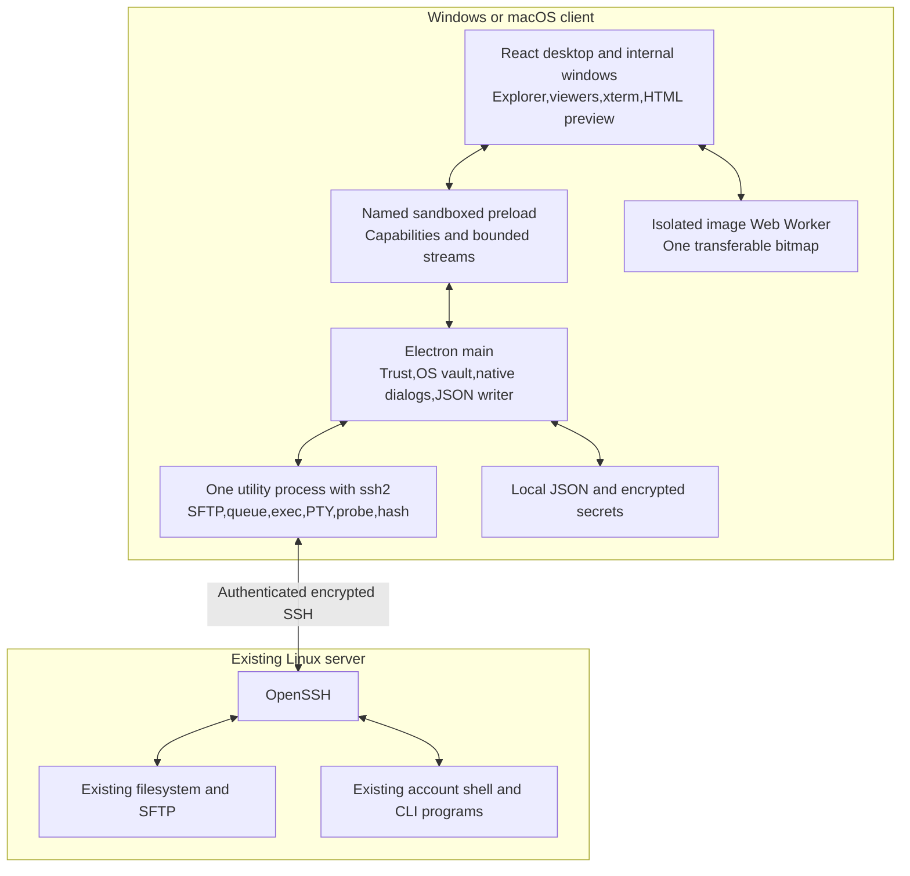

# sshOS System Architecture

Last updated:2026-11-17. This describes the implemented process layout. Native target and release acceptance remain separate.

## Ownership and Identity

Main composes restricted controllers, one JSON writer and a utility-process gateway. Renderer has no native authority. Preload exposes named APIs only. Worker owns all SSH sockets/remote operations; its receipt protocol awaits main ACK before effects. Shared modules are pure. Image decode runs in renderer Web Worker, not the SSH loop.

Every operation carries fixed serverId/sessionGeneration/backendEpoch/resource/request/sequence identity. Explicit selected-server control changes the displayed workspace and future defaults; focusing a window never changes its server. Existing work and late-event attribution remain bound. Internal window chrome is DOM. HTML content alone uses an isolated native WebContentsView positioned inside its DOM window; it is hidden for overlays, inactive windows and Console. No remote GUI forwarding is provided. Home contents and explorer windows use the same bounded SSH-command metadata capability pipeline. An independently owned PTY is attached to the Console view and remains allocated while Desktop or a navigation overlay is shown. Main acknowledges the hidden-files preference through the atomic JSON writer before notifying the renderer. xterm renders a remote PTY; node-pty/local shell/WebSocket bridge are unnecessary.

## SSH Resource Roles

At most 3 connected servers. Each owns control 1, transfer≤1 and execution≤1; at most 9 sockets including owned closing resources. Each socket verifies the same pinned host trust and selected authentication. Control has 1 serialized metadata queue shared by command queries/mutations and SFTP transaction checks. At most one metadata command channel, up to 2 viewer reads and 1 probe; viewer reads 4 globally. Transfers2 globally/1 per server, task-owned SFTP/socket retired at completion. GUI exec+PTY share 4/server and 6/global slots, including opening/closing; idle execution closes after the final channel's actual close.

A new rejected resource does not evict existing work. Transfer-only and execution-only failures preserve other roles. Control loss retires the owning generation and auxiliaries; other servers survive. No auto-reconnect/restart/replay.

## Content and Persistence Flows

Browsing and account home/start/OS discovery use fixed non-PTY SSH commands. Directory enumeration uses GNU find with NUL-delimited fields; stat supplies properties. The worker validates complete records, canonical parents, limits and observed exit. No SFTP metadata fallback is used for Desktop queries. Viewing uses bounded ephemeral SFTP bytes→strict text/header validation→plain content or isolated bitmap canvas. Main relays without generic snapshot/disk content cache.

Execution uses validated source/cwd capabilities→fixed confirmation→POSIX-quoted exec→bounded stdout/stderr/observed exit. PTY has separate sequenced input, resize, paste and restore ACK barriers. Remote strings never choose a new command or local authority.

Files use persisted intent→owned exclusive temp→bounded transfer→full SHA256 read-back→durable finalization→exclusive hardlink→destination observation→separate cleanup→receipt. Existing destinations remain intact. External writers and exec/PTY are outside SFTP path-lock participation.

Main stores checksummed state/receipts using one serialized atomic-replacement writer and backup. OS encryption protects explicitly saved secrets. Lost acknowledgements/backup recovery/dispatch uncertainty remain unknown, with no replay or inferred remote process death. Layout lives only in main memory; UI restoration is not reconnect.

## Network and Release Boundary

Automatic network is selected SSH plus necessary DNS; no management listener, server agent, DB, remote GUI, search/AI/telemetry/updater. Chromium renders the entire local GUI and is subject to offline resource policy. Production fuses and static package integrity do not substitute native launch, OS vault, accessibility, network capture or signing acceptance.

See [Architecture Contract](../../ai-agent/architecture-contract.md),Development Plan (private local material) and Traceability (private local material).

## Feature Boundaries

`main/file-operations` owns file capabilities, confirmation and receipts; `worker/remote-files/metadata` owns the Ubuntu command adapter/parser; `worker/remote-files/mutations` owns verified mutations. `worker/remote-files/sftp-control` is retained for file-content and transactional integrity operations. `main/web-preview` owns isolated sessions, root-scoped protocol resolution and native geometry. `renderer/features` groups desktop, file explorer, viewers, web preview, Console, settings, connections, execution, tasks and transfers. Pure locks/claims/failure classification live under `shared/file-policies`; selected native file inspection lives under `platform/local-files`. Main has no imports from worker internals.

## Command and HTML Limits

A metadata command uses the existing authenticated control socket and a dedicated non-PTY channel, never a Console terminal. Output is bounded to 10 MiB and 60 seconds for listings; a snapshot exposes at most 10,000 entries, 256 entries/192 KiB per page. Byte/entry limits produce an explicit partial listing; malformed complete output fails. Names unsupported by the existing path policy remain display-only. Current folders are enumerated only; hidden-file filtering is local. Directory total disk usage is not computed by basic properties.

Properties include numeric UID/GID, mode, byte size, modification time, device, inode and hardlink count. Inode/dev identity is included in mutation preparation. Remote filesystem checks and a subsequent command are not atomic with external writers. GNU mv must not overwrite and must not fall back to copying. A skipped rename is detected by postconditions. Recursive deletion is permanent, not atomic or reversible; failure can leave a partially removed tree. These operations do not use sudo or retry after uncertainty.

Rename additionally requires an immediate bounded preflight: Linux kernel 6.8 or later, parent filesystem magic `ef53` (ext family), `9123683e` (btrfs), `1021994` (tmpfs) or `58465342` (XFS), and `Seccomp: 0` from the SSH command process. Unknown, malformed, filtered or unavailable environments fail with `NOREPLACE_UNSUPPORTED` before `mv` dispatch. NFS, FUSE and overlay mounts are not accepted for rename. This deliberately narrows support because [coreutils 9.4's pinned gnulib implementation](https://github.com/coreutils/gnulib/blob/bb5bb43a1ebb9f502b5ce38c0b8c8778d13b9f6e/lib/renameatu.c) can fall back to a non-atomic existence check on unsupported environments. The gate assumes trusted unmodified Ubuntu tools, kernel and inherited SSH process policy. It is not remote attestation and does not protect against namespace replacement/remounts or command-specific syscall emulation between preflight and dispatch.

Each HTML preview initially grants only its containing directory. An explicit root change must still contain the selected document and identify a directory. The custom standard protocol maps relative resources into that root; SFTP reads reject symlink files and noncanonical parents. URL origin/root checks do not replace those filesystem checks. Root checks and opening still have an external-writer race; no remote filesystem sandbox or atomic snapshot is claimed. Resources are ephemeral bounded bytes, not a local disk cache. Per-load limits are 512 requests and 64 MiB total, each resource at most 20 MiB. Two web reads run globally, with at most 32 waiting; the worker's existing viewer pool also applies. Reload/root/JavaScript changes dispose the previous WebContents and revalidate revision identity.

The preview has no preload or sshOS bridge. Permission requests, downloads, popups, external origins, local file URLs, nested frames, plugins and workers are denied. JavaScript is disabled by default and can be explicitly enabled for that preview. This renders static files; it does not run PHP, start a server or reproduce server routing.

The per-revision web budget is reserved atomically from prepared SFTP size metadata before any content read. Failed/cancelled reservations remain charged. `viewer:peek` exposes bounded metadata only; the web reader limits content to that size plus at most one EOF/growth-verification byte, rejecting growth. Exhaustion blocks new opens and oversized resources never start content reads.

WebRTC constructors and legacy aliases are removed immutably in each main-world Window realm through a main-owned `Page.addScriptToEvaluateOnNewDocument` policy before loading any untrusted page. An inert owned about:blank initializes the renderer first. The internal debugger transport stays attached; detach, renderer failure or failed policy setup closes that preview. It exposes no debugger or Node API to the page and starts no debugging listener. URL/CSP filtering remains in place; WebRTC IP handling is secondary defense only. Pinned Chromium does not enforce the draft CSP webrtc directive.
