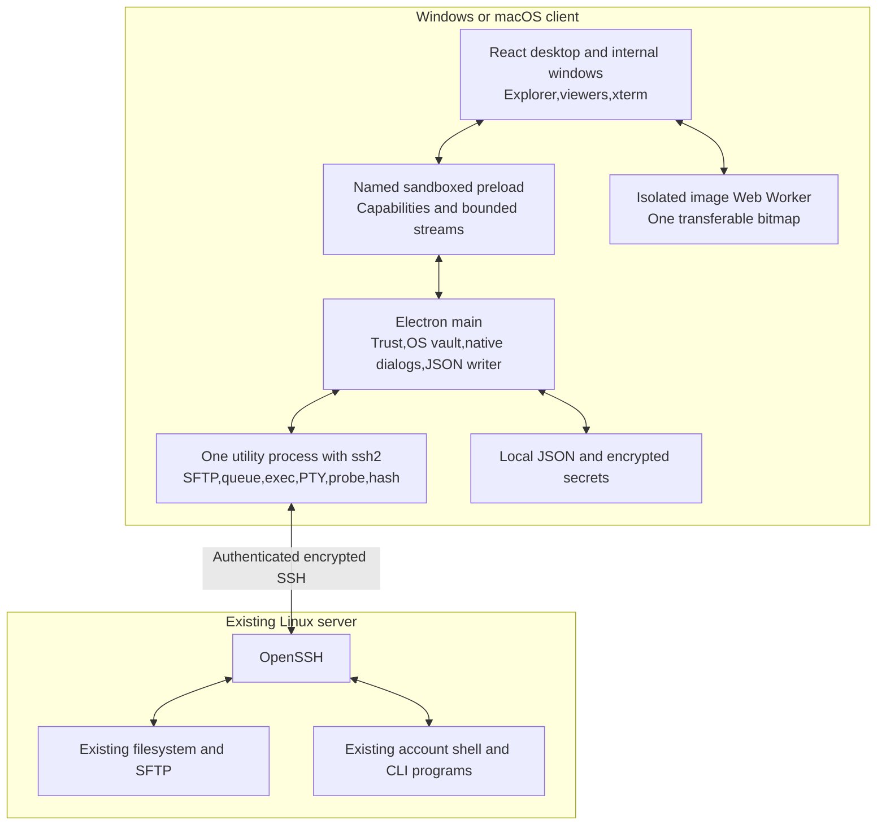

# sshOS System Architecture

Last updated:2026-11-15. This describes the implemented process layout. Native target and release acceptance remain separate.

## Ownership and Identity

Main composes restricted controllers, one JSON writer and a utility-process gateway. Renderer has no native authority. Preload exposes named APIs only. Worker owns all SSH sockets/remote operations; its receipt protocol awaits main ACK before effects. Shared modules are pure. Image decode runs in renderer Web Worker, not the SSH loop.

Every operation carries fixed serverId/sessionGeneration/backendEpoch/resource/request/sequence identity. Explicit selected-server control changes the displayed workspace and future defaults; focusing a window never changes its server. Existing work and late-event attribution remain bound. Internal windows are DOM, not BrowserWindows/X11 windows. Home contents and explorer windows use the same bounded SFTP capability pipeline. An independently owned PTY is attached to the Console view and remains allocated while Desktop or a navigation overlay is shown. Main acknowledges the hidden-files preference through the atomic JSON writer before notifying the renderer. xterm renders a remote PTY; node-pty/local shell/WebSocket bridge are unnecessary.

## SSH Resource Roles

At most 3 connected servers. Each owns control 1, transfer≤1 and execution≤1; at most 9 sockets including owned closing resources. Each socket verifies the same pinned host trust and selected authentication. Control has 1 serialized metadata SFTP, up to 2 viewer reads and 1 probe; viewer reads 4 globally. Transfers2 globally/1 per server, task-owned SFTP/socket retired at completion. GUI exec+PTY share 4/server and 6/global slots, including opening/closing; idle execution closes after the final channel's actual close.

A new rejected resource does not evict existing work. Transfer-only and execution-only failures preserve other roles. Control loss retires the owning generation and auxiliaries; other servers survive. No auto-reconnect/restart/replay.

## Content and Persistence Flows

Browsing uses structured SFTP metadata. Viewing uses bounded ephemeral SFTP bytes→strict text/header validation→plain content or isolated bitmap canvas. Main relays without generic snapshot/disk content cache.

Execution uses validated source/cwd capabilities→fixed confirmation→POSIX-quoted exec→bounded stdout/stderr/observed exit. PTY has separate sequenced input, resize, paste and restore ACK barriers. Remote strings never choose a new command or local authority.

Files use persisted intent→owned exclusive temp→bounded transfer→full SHA256 read-back→durable finalization→exclusive hardlink→destination observation→separate cleanup→receipt. Existing destinations remain intact. External writers and exec/PTY are outside SFTP path-lock participation.

Main stores checksummed state/receipts using one serialized atomic-replacement writer and backup. OS encryption protects explicitly saved secrets. Lost acknowledgements/backup recovery/dispatch uncertainty remain unknown, with no replay or inferred remote process death. Layout lives only in main memory; UI restoration is not reconnect.

## Network and Release Boundary

Automatic network is selected SSH plus necessary DNS; no management listener, server agent, DB, remote GUI, search/AI/telemetry/updater. Chromium renders the entire local GUI and is subject to offline resource policy. Production fuses and static package integrity do not substitute native launch, OS vault, accessibility, network capture or signing acceptance.

See [Architecture Contract](../../ai-agent/architecture-contract.md),Development Plan (private local material) and Traceability (private local material).
